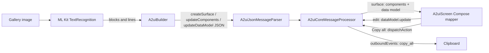

# WordLens: ML Kit + A2UI sample

A small Android app that scans text from an image and shows it in a UI that is **generated at runtime from A2UI messages**.

`Image → ML Kit → structured data → A2UI messages → A2UI engine → Compose UI`

## What it does
1. Pick an image from the gallery (system photo picker, no permissions needed).
2. ML Kit recognizes the text on-device.
3. `A2uiBuilder` turns the result into A2UI v0.9 JSON messages.
4. The official `androidx.a2ui` engine parses, validates and holds the UI state.
5. A thin Compose layer draws it. Edit any line, or press **Copy all**.

The number of cards and fields depends on the image: one Card per ML Kit text block, one TextField per line.



## ML Kit
`TextScanner.kt` runs the bundled Latin `TextRecognition` model (works offline) and returns `List<List<String>>`: blocks, each a list of lines.

## A2UI
[A2UI](https://a2ui.org) is a protocol where an agent sends declarative JSON describing a UI, and the client renders it with native widgets. The client only draws components it has declared in a *catalog*, so the agent cannot run arbitrary code. Here there is no LLM: the "agent" is `A2uiBuilder`, which generates the messages locally.

### What is official and what is ours
Google publishes `androidx.a2ui:a2ui-engine` and `a2ui-model` (`1.0.0-alpha02`). **There is no official Compose renderer**, so this sample provides the glue itself:

| Official (`androidx.a2ui`) | This repo |
|---|---|
| JSON message parser, protocol model | `JsonElementReader`, the reader the parser needs (`A2uiRuntime.kt`) |
| Message processor, surfaces, schema validation | `WordLensCatalog`: five component definitions (Column, Card, Text, TextField, Button) |
| Data-binding evaluation (`evaluatePayload`) | `MapDataModel`, `ComponentRegistry`: storage backed by Compose state |
| Action dispatch, outbound events | `A2uiScreen.kt`: maps each component to Material 3 |

## Messages
`buildA2uiMessages` emits three messages, e.g. for one line `hello`:
```json
{"version":"v0.9","createSurface":{"surfaceId":"scan-1","catalogId":"wordlens:catalog/v1"}}
{"version":"v0.9","updateComponents":{"surfaceId":"scan-1","components":[
  {"id":"field0","component":"TextField","label":"Block 1 · line 1","value":{"path":"/lines/0"}}, "..."]}}
{"version":"v0.9","updateDataModel":{"surfaceId":"scan-1","path":"/","value":{"lines":["hello"]}}}
```
Text fields don't hold their text; they **bind** to `/lines/N` in the data model.

## Interactions
- **Editing**: a TextField writes its new value to the data model path it is bound to.
- **Copy all**: the Button carries `{"event": {"name": "copy_all", "context": {"0000": {"path": "/lines/0"}, ...}}}`. On press the engine resolves each path to its *current* value and emits an outbound event. `MainActivity` collects it and puts the joined text on the clipboard.

## Build and run
Requires Android Studio (or JDK 17+ and the Android SDK) and a device or emulator with API 33+.
```
./gradlew :app:assembleDebug :app:testDebugUnitTest
./gradlew :app:installDebug
```

## Commits
| Commit | Purpose |
|---|---|
| initialize Android project structure… | Compose template |
| feat: add image picker | Photo picker and preview |
| feat: integrate ML Kit text recognition | OCR with loading and error states |
| feat: integrate official A2UI renderer | Engine wiring, catalog, Compose mapper |
| feat: transform ML Kit results into A2UI messages | Cards and fields generated from OCR output |
| feat: handle interactions from generated A2UI | Edit binding and Copy all event |
| refactor: simplify and polish sample application | Scrolling and preview size |
| docs: add README with integration explanation | This file |

## Limitations
- `androidx.a2ui` is alpha; the API may change.
- `MapDataModel` stores leaf values only; it cannot read a whole list or object from a parent path.
- Only the five components above are rendered; unknown types are ignored.
