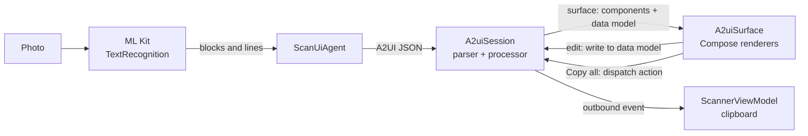
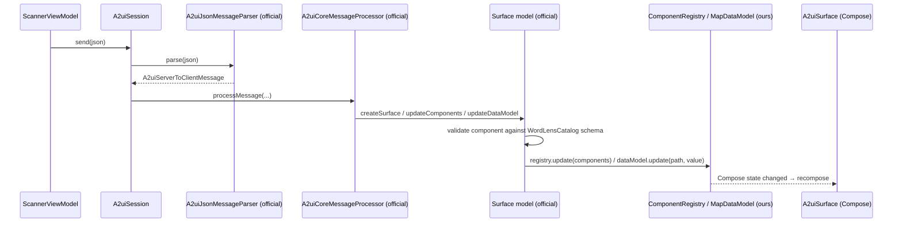

# WordLens: learn ML Kit + A2UI

WordLens is a small Android app. It reads text from a photo with **Google ML Kit** and shows it in an interactive UI that is **generated at runtime as A2UI messages**. This README is also a step-by-step tutorial for both technologies.

```
Image → ML Kit → blocks & lines → A2UI messages → A2UI engine → Compose UI
```

---

## Contents
1. [What you'll build](#1-what-youll-build)
2. [Project tour](#2-project-tour)
3. [ML Kit in 5 minutes](#3-ml-kit-in-5-minutes)
4. [A2UI concepts](#4-a2ui-concepts)
5. [Walkthrough: one real scan](#5-walkthrough-one-real-scan)
6. [How the engine processes messages](#6-how-the-engine-processes-messages)
7. [From payload to pixels: typed models and renderers](#7-from-payload-to-pixels-typed-models-and-renderers)
8. [Interactions](#8-interactions)
9. [Tutorial: add a new component yourself](#9-tutorial-add-a-new-component-yourself)
10. [Exercises](#10-exercises)
11. [Build, run, test](#11-build-run-test)
12. [Commit history](#12-commit-history)
13. [Limitations](#13-limitations)

---

## 1. What you'll build

1. Pick a photo (system photo picker, no permissions needed).
2. ML Kit reads the text **on-device**, so no network is needed.
3. An "agent" turns the text into A2UI JSON messages.
4. The official `androidx.a2ui` engine parses and validates them, and holds the UI state.
5. Our Compose renderers draw the result:
   - a header,
   - an **Edit** tab with one card per text block and one field per line,
   - a **Preview** tab,
   - and a **Copy all** button.

The UI is not hard-coded. A photo with 3 text blocks gets 3 cards; a photo with 1 block gets 1.



---

## 2. Project tour

All code is in `app/src/main/java/com/whoisabel/wordlens/`. Each file does one job.

```
MainActivity.kt                   Sets the theme and shows ScannerScreen. Nothing else.

scan/
  TextScanner.kt                  ML Kit: Uri → List<List<String>> (blocks of lines)

a2ui/
  agent/                          ── the SERVER side of A2UI (normally an LLM or backend)
    A2uiMessages.kt               JSON helpers: createSurface, updateComponents, updateDataModel…
    ScanUiAgent.kt                Decides WHAT UI to show for a scan result
  engine/                         ── the CLIENT side: plugs our app into the official engine
    A2uiSession.kt                Owns the official parser and message processor
    WordLensCatalog.kt            Which components exist, and the property schema of each
    MapDataModel.kt               Where bound values live (Compose state)
    ComponentRegistry.kt          Where validated components live (Compose state)
    JsonElementReader.kt          Adapter that lets the official parser read JSON
  model/
    A2uiComponent.kt              Typed Kotlin classes: Text, Row, Tabs, TextField…
  render/                         ── turns typed components into Compose widgets
    A2uiSurface.kt                Entry point + the one `when` that picks a renderer
    LayoutRenderers.kt            Column, Row, Card, Divider, Tabs
    ContentRenderers.kt           Text, Icon
    InputRenderers.kt             TextField, Button

ui/
  ScannerViewModel.kt             Runs the pipeline; survives rotation
  ScannerScreen.kt                Arranges the screen sections
  sections/                       Hero, EmptyState, ImagePreview, ErrorCard, ResultSection
  components/GradientButton.kt    Shared button
  theme/                          Colors, gradient, typography
```

**Reading order for learning:**
1. `scan/TextScanner.kt`
2. `a2ui/agent/ScanUiAgent.kt`
3. `a2ui/engine/A2uiSession.kt`
4. `a2ui/model/A2uiComponent.kt`
5. `a2ui/render/A2uiSurface.kt`
6. `ui/ScannerViewModel.kt`

---

## 3. ML Kit in 5 minutes

[ML Kit](https://developers.google.com/ml-kit) is Google's on-device machine learning SDK. We use **Text Recognition v2** with the bundled Latin model (`com.google.mlkit:text-recognition`). The model ships inside the APK, so it works offline from the first launch.

### The three steps

```kotlin
// scan/TextScanner.kt
val recognizer = TextRecognition.getClient(TextRecognizerOptions.DEFAULT_OPTIONS) // 1. a recognizer
val image = InputImage.fromFilePath(context, uri)                                   // 2. an input image
val result: Text = recognizer.process(image).await()                               // 3. run it
recognizer.close()
```

- **`InputImage`**: ML Kit's image wrapper. It can be built from a `Uri`, a `Bitmap`, a `media.Image` (CameraX) or a byte buffer. `fromFilePath` also reads EXIF rotation for you.
- **`process()`** returns a Play Services `Task`. We turn it into a suspend function with a 4-line `await()` helper based on `suspendCancellableCoroutine`, so we don't need an extra dependency.
- **`close()`** releases the native model.

### The result hierarchy

```
Text                      result.text: the whole string
 └ TextBlock              a paragraph or column       → one Card in our UI
    └ Line                one line of text            → one TextField in our UI
       └ Element          a word
          └ Symbol        a character
```

Every level also has a `boundingBox`, `cornerPoints`, `recognizedLanguage` and a `confidence` value. WordLens keeps only blocks and lines:

```kotlin
return result.textBlocks.map { block -> block.lines.map { it.text } }   // List<List<String>>
```

That `List<List<String>>` (type alias `Blocks`) is the whole contract between ML Kit and A2UI.

---

## 4. A2UI concepts

[A2UI](https://a2ui.org) (Agent-to-User Interface) is an open protocol. An **agent** (usually an LLM or a server) describes a UI as **JSON data**, and the **client** renders it with its own native widgets.

The agent never sends code, only declarations. The client renders only components it has declared, so it stays safe and keeps its own look.

| Concept | What it is | In WordLens |
|---|---|---|
| **Surface** | An independent UI region with its own components and data. | One per scan, e.g. `scan-123456` |
| **Catalog** | The list of component types the client supports, each with a JSON schema for its properties. | `WordLensCatalog`: 9 components |
| **Component** | `{"id": "...", "component": "Text", ...properties}`. Components form a **flat list**; parents reference children **by id**. | `ScanUiAgent` builds about 30 for a 4-line scan |
| **Data model** | A JSON document attached to the surface. | `{"lines": ["INVOICE 2026-001", ...]}` |
| **Binding** | A property value of `{"path": "/lines/0"}` means "read this from the data model". | Every field and preview line |
| **Action** | What happens on interaction: an `event` sent to the agent, or a local `functionCall`. | Copy all sends the event `copy_all` |

### The four message types (agent → client)

| Message | Purpose |
|---|---|
| `createSurface` | Start a surface and choose its catalog |
| `updateComponents` | Add or replace components (the whole tree or just a part) |
| `updateDataModel` | Write a value at a path in the data model |
| `deleteSurface` | Remove the surface |

Every message is wrapped in an envelope: `{"version": "v0.9", "<messageType>": { ... }}`.

### Official library vs. this repo

Google publishes the protocol engine as `androidx.a2ui:a2ui-engine` and `a2ui-model` (`1.0.0-alpha02`). **There is no official Compose renderer**, so `a2ui/engine` plugs our storage into the engine, and `a2ui/render` draws the components.

| Official `androidx.a2ui` does | This repo does |
|---|---|
| Parse JSON messages, check the protocol version | Give the parser a JSON reader (`JsonElementReader`) |
| Manage surfaces (one actor per surface) | Declare the catalog (`WordLensCatalog`) |
| **Validate** each component against the catalog schemas | Store components and data (`ComponentRegistry`, `MapDataModel`) |
| **Resolve bindings** (`evaluatePayload`) | Render typed components with Material 3 (`a2ui/render`) |
| Turn actions into outbound events | React to events (`ScannerViewModel`) |

---

## 5. Walkthrough: one real scan

The sample image has two paragraphs: "INVOICE 2026-001 / WordLens Coffee Shop" and "Total: 42.50 EUR / Thank you!". ML Kit returns:

```kotlin
listOf(
    listOf("INVOICE 2026-001", "WordLens Coffee Shop"),   // block 0
    listOf("Total: 42.50 EUR", "Thank you!"),             // block 1
)
```

`ScanUiAgent.buildA2uiMessages()` turns this into **three messages** (shortened here):

**① createSurface**: "a new UI, drawn with my catalog"
```json
{"version": "v0.9", "createSurface": {"surfaceId": "scan-123", "catalogId": "wordlens:catalog/v1"}}
```

**② updateComponents**: the component tree as a flat list
```json
{"version": "v0.9", "updateComponents": {"surfaceId": "scan-123", "components": [
  {"id": "root",       "component": "Column", "children": ["header", "tabs"]},
  {"id": "header",     "component": "Row", "align": "center", "children": ["headerIcon", "summary"]},
  {"id": "headerIcon", "component": "Icon", "name": "search"},
  {"id": "summary",    "component": "Text", "variant": "h3", "text": "4 lines in 2 blocks"},
  {"id": "tabs",       "component": "Tabs", "tabs": [
      {"title": "Edit", "child": "editTab"}, {"title": "Preview", "child": "previewCard"}]},
  {"id": "field0",     "component": "TextField", "label": "Line 1", "value": {"path": "/lines/0"}},
  {"id": "card0",      "component": "Card", "child": "block0"},
  {"id": "block0",     "component": "Column", "children": ["blockHeader0", "divider0", "field0", "field1"]},
  {"id": "divider0",   "component": "Divider"},
  {"id": "copy",       "component": "Button", "child": "copyContent",
      "action": {"event": {"name": "copy_all", "context": {"0000": {"path": "/lines/0"}, "0001": {"path": "/lines/1"}}}}},
  {"id": "preview0",   "component": "Text", "text": {"path": "/lines/0"}}
]}}
```
What to notice:
- **The tree is flat.** `root` lists `header` and `tabs` by id, and the order in the array doesn't matter. An agent can stream or patch single components without resending the whole tree.
- **`text: "4 lines…"` is a literal; `value: {"path": …}` is a binding.** The same property accepts either.
- **`field0` and `preview0` bind to the same path.** That is why the Preview tab updates while you type.

**③ updateDataModel**: the data the bindings read
```json
{"version": "v0.9", "updateDataModel": {"surfaceId": "scan-123", "path": "/",
  "value": {"lines": ["INVOICE 2026-001", "WordLens Coffee Shop", "Total: 42.50 EUR", "Thank you!"]}}}
```

Components describe **structure**; the data model holds **values**. To change the text without rebuilding the UI, an agent only sends `updateDataModel`.

> Try it: in `ScanUiAgentTest`, print `buildA2uiMessages("s", listOf(listOf("hi")))` to see the real, complete JSON.

---

## 6. How the engine processes messages



Key points in `engine/`:

- **`A2uiSession`** builds `A2uiCoreMessageProcessor(catalogs, dataModelFactory, componentRegistryFactory)`. `run()` must be running for messages to be processed; the ViewModel launches it in `viewModelScope`.
- **`WordLensCatalog`** declares each component's property schema, for example `Text(text: DynamicString, variant: String)`. A component that fails validation never reaches the registry, and the engine reports an error on `outboundEvents` instead.
- **`ComponentRegistry`** and **`MapDataModel`** are the two interfaces the engine asks the host app to implement. We back both with `mutableStateMapOf`, so any change (from the agent or from a TextField) recomposes exactly the widgets that read it.
- **`JsonElementReader`**: the parser reads JSON through an `A2uiJsonReader` interface but ships no implementation, so we adapt `kotlinx.serialization`.

---

## 7. From payload to pixels: typed models and renderers

The engine hands us untyped payloads: `A2uiComponentPayload(id, type = "Text", properties = Map<String, Any?>)`. We convert each payload **once** into a typed model:

```kotlin
// a2ui/model/A2uiComponent.kt
sealed interface A2uiComponent {
    data class Text(override val id: String, val text: Any?, val variant: String) : A2uiComponent
    data class Row(override val id: String, val children: List<String>, val justify: String, val align: String) : A2uiComponent
    data class Tabs(override val id: String, val tabs: List<Tab>) : A2uiComponent
    // … Column, Card, Divider, Icon, TextField, Button, Unknown
    companion object { fun from(payload: A2uiComponentPayload): A2uiComponent }
}
```

Then **one exhaustive `when`** picks the renderer:

```kotlin
// a2ui/render/A2uiSurface.kt
when (component) {
    is A2uiComponent.Text -> TextRenderer(surface, component, modifier)
    is A2uiComponent.Tabs -> TabsRenderer(surface, component, modifier)
    …
}
```

Because the interface is `sealed`, adding a new component class makes this `when` fail to compile until you write its renderer.

**Dynamic values stay raw.** `Text.text` is `Any?` because it can be `"hello"` or `{"path": "/lines/0"}`. Renderers never parse bindings themselves; they ask the official engine:

```kotlin
internal fun A2uiCoreSurfaceModel.resolveString(componentId: String, raw: Any?): String =
    evaluatePayload(componentId, { dataModel[it] }, A2uiDataPath("/"), raw) as? String ?: ""
```

This runs during composition, so reading `dataModel[...]` subscribes the widget to that value.

**Children are drawn by id.** Layout renderers call `RenderComponent(surface, childId)`, which looks the child up in the registry. This is how a flat list becomes a tree on screen.

---

## 8. Interactions

### Editing: two-way binding (client only)
```kotlin
// render/InputRenderers.kt
OutlinedTextField(
    value = surface.resolveString(field.id, field.value),                         // read /lines/3
    onValueChange = { new -> surface.dataModel.update(A2uiDataPath(path), new) },  // write /lines/3
)
```
Typing writes into the data model. Every component bound to that path recomposes, including the Preview tab's Text, and the agent is not involved.

### Copy all: action → event → host
1. The Button's `action` is `{"event": {"name": "copy_all", "context": {"0000": {"path": "/lines/0"}, …}}}`.
2. On tap, the renderer calls `surface.dispatchAction(id, action)` (official API).
3. The engine **resolves the context bindings against the current data model**, so you get the *edited* text, and emits an `A2uiClientEventMessage` on `processor.outboundEvents`.
4. `ScannerViewModel.copiedText` filters for `copy_all` and joins the lines. `ScannerScreen` puts the result on the clipboard and shows a snackbar.

In a networked app, step 4 would send the event to the agent. The agent could then reply with new `updateComponents` or `updateDataModel` messages.

### Tabs: local UI state
Which tab is selected is **not** in the data model. It's plain `rememberSaveable` state in `TabsRenderer`. Rule of thumb: what the agent should know about goes in the data model; purely visual state stays in the renderer.

---

## 9. Tutorial: add a new component yourself

Let's add the basic catalog's **CheckBox** (`label: DynamicString`, `value: DynamicBoolean`). You'll touch four files, in the same order the data flows.

**Step 1: declare it in the catalog** (`engine/WordLensCatalog.kt`)
```kotlin
Component(
    "CheckBox", "Boolean toggle bound to the data model",
    mapOf("label" to A2uiDynamicStringSchema.DEFAULT_INSTANCE, "value" to A2uiDynamicBooleanSchema.DEFAULT_INSTANCE),
    setOf("label", "value"),
),
```
Without this step the engine rejects any CheckBox an agent sends. Try it: skip this step, and `A2uiSessionTest` will fail because the component never reaches the registry.

**Step 2: add a typed model** (`model/A2uiComponent.kt`)
```kotlin
data class CheckBox(override val id: String, val label: Any?, val value: Any?) : A2uiComponent {
    val boundPath: String? get() = (value as? Map<*, *>)?.get("path") as? String
}
// in from():
"CheckBox" -> CheckBox(id, p["label"], p["value"])
```
Now build: the compiler points you to the `when` in `A2uiSurface.kt`, which is no longer exhaustive.

**Step 3: render it** (`render/InputRenderers.kt`, then add a branch in `A2uiSurface.kt`)
```kotlin
@Composable
internal fun CheckBoxRenderer(surface: A2uiCoreSurfaceModel, box: A2uiComponent.CheckBox, modifier: Modifier) {
    val checked = surface.evaluatePayload(box.id, { surface.dataModel[it] }, A2uiDataPath("/"), box.value) as? Boolean ?: false
    Row(modifier, verticalAlignment = Alignment.CenterVertically) {
        Checkbox(checked, onCheckedChange = { c -> box.boundPath?.let { surface.dataModel.update(A2uiDataPath(it), c) } })
        Text(surface.resolveString(box.id, box.label))
    }
}
// A2uiSurface.kt
is A2uiComponent.CheckBox -> CheckBoxRenderer(surface, component, modifier)
```

**Step 4: let the agent use it** (`agent/ScanUiAgent.kt`)

For example, an "include" checkbox per line, bound to `/include/<n>`:
```kotlin
add(component("include$n", "CheckBox", "label" to str("Include"), "value" to bound("/include/$n")))
// and in updateDataModel: "include" to JsonArray(lines.map { JsonPrimitive(true) })
```

**Step 5: test it**

Add a case to `A2uiComponentTest` for the typed model. `A2uiSessionTest.engineAcceptsGeneratedMessages` already proves the engine accepts everything the agent generates.

---

## 10. Exercises

1. **Copy only checked lines.** After §9, add `/include/<n>` to the Copy button's event context and filter in `copyText()`.
2. **Streaming.** Send `updateComponents` once per block with a `delay(300)` between them, and watch the cards appear one by one. (The flat component list makes this possible.)
3. **Agent reacts to events.** When `copy_all` arrives, have the ViewModel send `updateDataModel` to set a new `/status` path, and show it in a Text bound to `/status`.
4. **Use word-level data.** Change `scanText` to also return ML Kit `Element`s, and render the words of each line as chips in a `Row`.
5. **Confidence.** Show each line's `confidence` from ML Kit as a caption under its field.

---

## 11. Build, run, test

Requirements: Android Studio (or JDK 17+ and the Android SDK), and a device or emulator on **API 33+**.

```bash
./gradlew :app:assembleDebug          # build
./gradlew :app:testDebugUnitTest      # unit tests (JVM, no device needed)
./gradlew :app:installDebug           # install on the connected device
```

| Test | What it proves |
|---|---|
| `ScanUiAgentTest` | The UI shape follows the text (cards = blocks, fields = lines). Every referenced child id exists. Fields and preview bind to the same paths. |
| `A2uiComponentTest` | Payloads become the right typed models. |
| `A2uiSessionTest` | The **real engine** accepts every generated component, and an edit made in the data model reaches the `copy_all` event. |

---

## 12. Commit history

The history is meant to be read step by step: `git log --reverse --oneline`.

| Commit | What it adds |
|---|---|
| initialize Android project structure… | Compose template |
| feat: add image picker | Photo picker and preview |
| feat: integrate ML Kit text recognition | OCR with loading and error states |
| feat: integrate official A2UI renderer | Engine wiring, catalog, first Compose mapper |
| feat: transform ML Kit results into A2UI messages | Cards and fields generated from OCR output |
| feat: handle interactions from generated A2UI | Edit binding and Copy all event |
| refactor: simplify and polish sample application | Scrolling and preview size |
| docs: add README with integration explanation | First README |
| feat: redesign UI with brand gradient and animations | Hero, onboarding, scan animation, styled cards |
| refactor: split A2UI runtime into agent and engine packages | One file per responsibility |
| refactor: parse A2UI payloads into typed component models | Sealed models, exhaustive renderer dispatch |
| refactor: move scan logic to ScannerViewModel and split screen sections | Thin Activity, rotation-safe state |
| feat: render Row, Icon, Divider and Tabs | More basic-catalog components, Edit/Preview tabs |
| docs: add step-by-step ML Kit and A2UI tutorial to README | This tutorial |

---

## 13. Limitations

- `androidx.a2ui` is **alpha** (`1.0.0-alpha02`), so its API may change.
- The Compose renderers are ours, not an official A2UI renderer. They cover 9 of the basic catalog's 18 components.
- `MapDataModel` stores leaf values only: reading `/lines` as a whole list returns null. That's enough for leaf bindings like `/lines/0`.
- `Icon` maps the spec names that exist in `material-icons-core`; any other name shows an info icon.
- Only Latin script is recognized. Other ML Kit models (Chinese, Devanagari, Japanese, Korean) are separate dependencies.